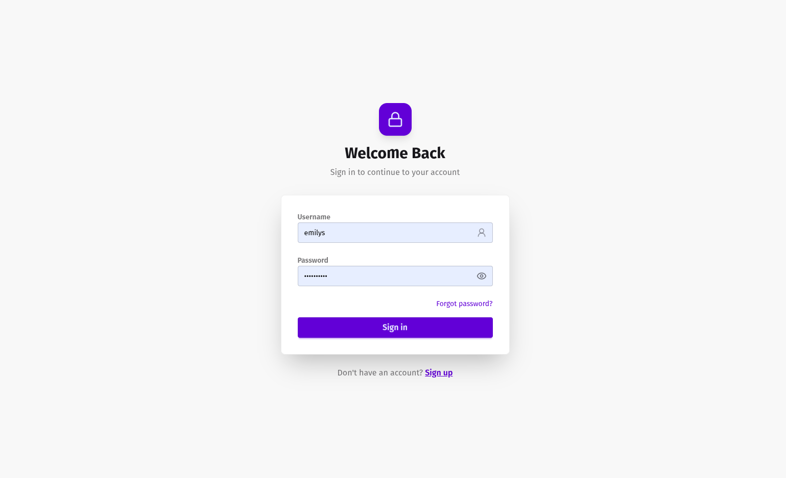
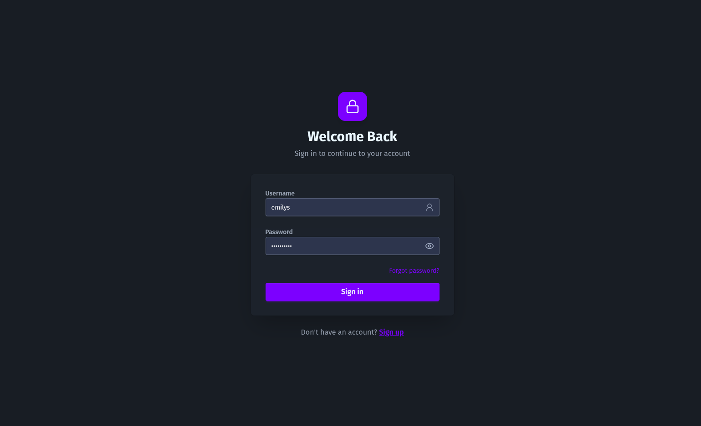
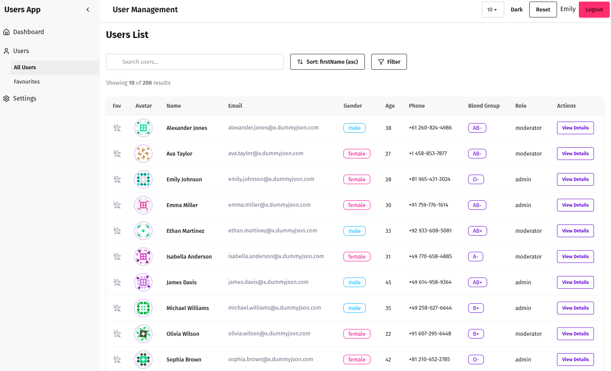
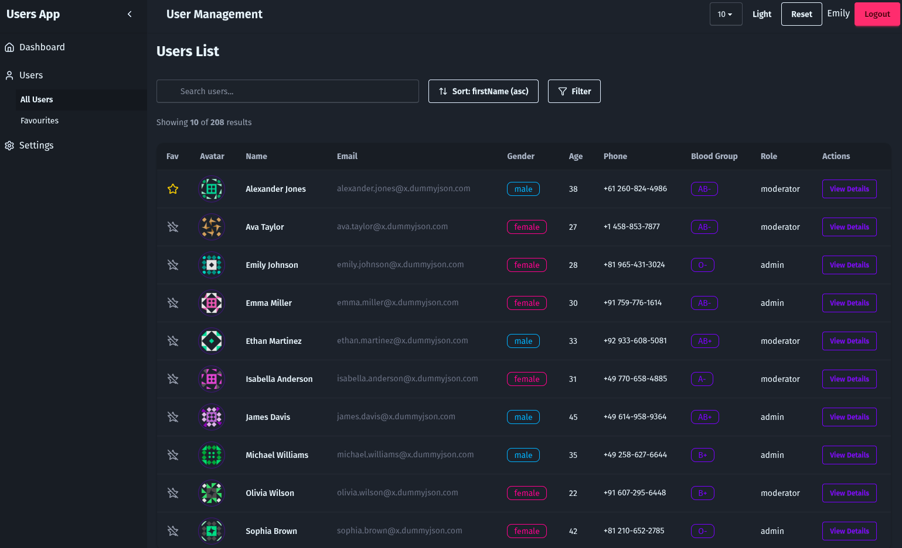
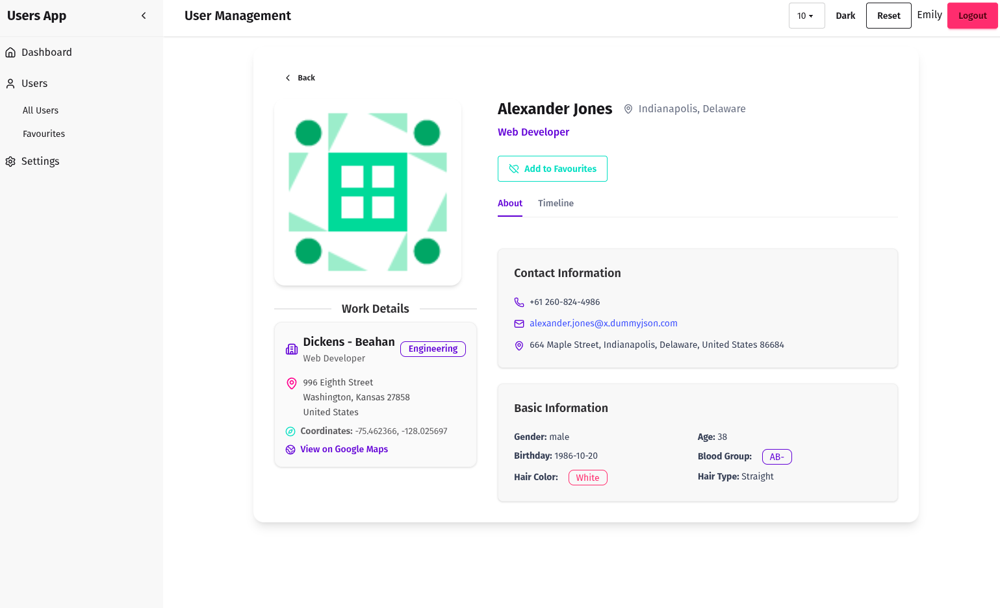
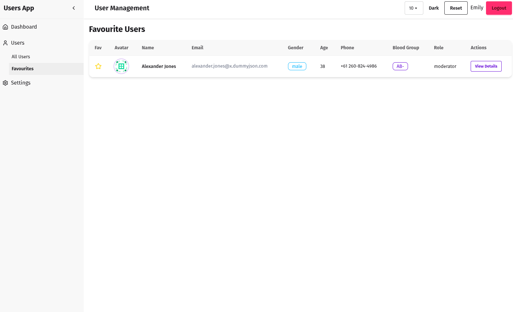
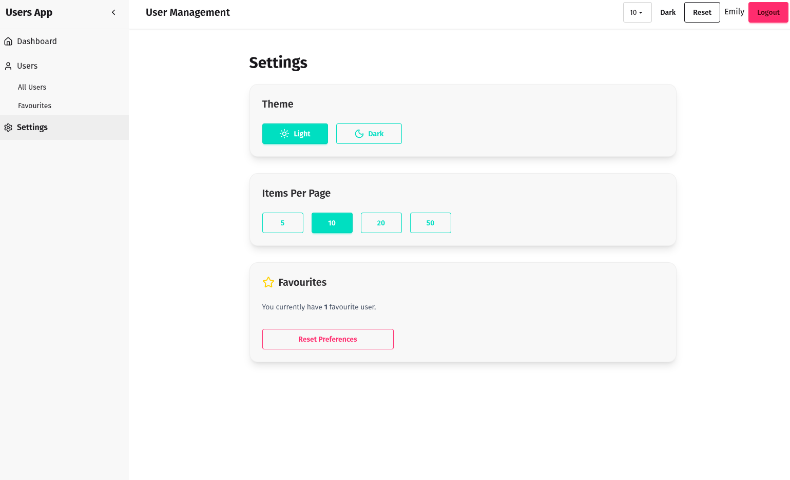

<!-- @format -->

# User App

A **ReactJS + Vite** application that allows user authentication, viewing/managing users, favorites, and persistent preferences. Built with **React 19.1**, **React Router v7**, **daisyUI**, and **Vite**.

Uses the [DummyJSON API](https://dummyjson.com/docs/users) for users and authentication.

---

## Features

1. **User Authentication**

   - Full login/logout flow via DummyJSON API.
   - Token management with auto-refresh before expiry.
   - Protected routes using `AuthContext`.
     
     

2. **User List Page**

   - Display users fetched from API.
   - Pagination, search, and sorting.
   - Favorite users with persistent storage.
   - Built with **daisyUI** components.
     
     

3. **User Detail Page**

   - View detailed user information.
   - “Back to List” navigation.
     

4. **Favorites Page**

   - Displays users marked as favorite.
   - Persistent across reloads using `UIContext`.
     

5. **Persistent Preferences**

   - Theme toggle (light/dark).
   - Items per page selection.
   - Reset preferences button to revert to defaults.
     

6. **Hooks**

   - `useAuth` for auth context consumption.
   - `useUI` for UI context consumption (theme, favorites, items per page).

7. **Responsive UI**

   - DaisyUI components for clean and responsive design.

---

## Prerequisites

- Node.js v20+
- npm v9+ or yarn
- Git

---

## Project Setup

### 1. Clone the Repository

```bash
git clone https://github.com/fearalert/user-app.git
cd user-app
```

### 2. Install Dependencies

```bash
npm install
# or
yarn install
```

### 3. Configure Environment

Create `.env` file at root if needed:

```env
VITE_API_URL=https://dummyjson.com
```

### 4. Run Development Server

```bash
npm run dev
# or
yarn dev
```

Open [http://localhost:5173](http://localhost:5173).

---

## Project Structure

```
src/
├─ api/
│  └─ apiClient.ts
├─ components/
│  ├─ Header.tsx
│  ├─ Layout.tsx
│  ├─ Login.tsx
│  ├─ Pagination.tsx
│  ├─ Sidebar.tsx
│  ├─ UserTable.tsx
│  └─ WorkDetails.tsx
├─ contexts/
│  ├─ AuthContext.tsx
│  └─ UIContext.tsx
├─ hooks/
│  ├─ useAuth.tsx
│  └─ useUI.tsx
├─ pages/
│  ├─ Dashboard.tsx
│  ├─ Favourites.tsx
│  ├─ LoginPage.tsx
│  ├─ NotFoundPage.tsx
│  ├─ Settings.tsx
│  ├─ UserDetails.tsx
│  └─ Users.tsx
├─ routes/
│  ├─ AppRoutes.tsx
│  └─ Protected.tsx
├─ types/
│  └─ index.ts
├─ utils/
│  └─ cookieStorage.ts
├─ App.tsx
├─ main.jsx
└─ index.css
```

---

## Authentication Flow

1. User logs in via `LoginPage`.
2. Tokens and user details are stored in **cookies** using `cookieStorage`.
3. `AuthContext` provides `auth`, `login`, `logout`, and `extendSession`.
4. Tokens are refreshed automatically 1 minute before expiry.

---

## UI & Preferences

- Managed via `UIContext` and `useUI` hook.
- Stores:

  - `theme`: light/dark
  - `itemsPerPage`: number of items to show per page
  - `favorites`: array of favorite user IDs

- Theme applied using `data-theme` attribute.
- Favorites and preferences persist via `cookieStorage`.
- Reset preferences clears theme, itemsPerPage, and favorites.

---

## Hooks

- `useAuth()` – provides authentication state and actions.
- `useUI()` – provides theme, itemsPerPage, favorites, and actions to toggle/reset.

---

## Routing

- `/login` – Login page
- `/users` – Users list (protected)
- `/users/:id` – User details (protected)
- `/favourites` – Favorite users (protected)
- `/settings` – User preferences (protected)
- `*` – NotFoundPage

---

## Available Scripts

```bash
npm run dev      # Start dev server
npm run build    # Build production bundle
npm run preview  # Preview production build
npm run lint     # Lint the project
```

---

## DaisyUI Integration

- Uses daisyUI components and themes
- Responsive design for desktop and mobile.

---

## Deployment

1. Build the project:

```bash
npm run build
```

2. Serve `dist/` using Netlify, Vercel, or GitHub Pages.

---

## References

- [DummyJSON Users API](https://dummyjson.com/docs/users)
- [DummyJSON Auth API](https://dummyjson.com/docs/auth)
- [React Router v7](https://reactrouter.com/en/main)
- [daisyUI Themes](https://daisyui.com/docs/themes/?lang=en)
- [Vite](https://vitejs.dev/)
